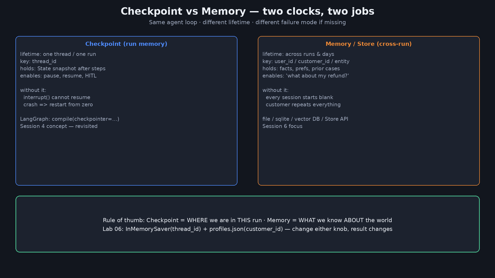
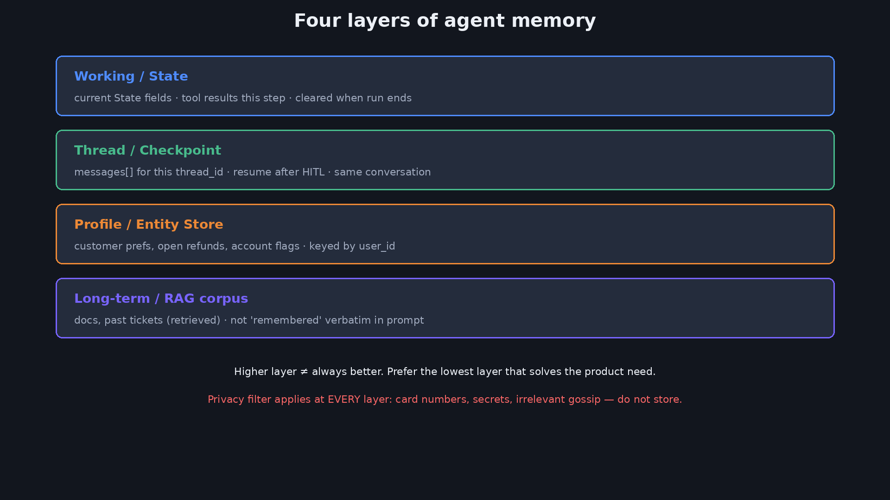
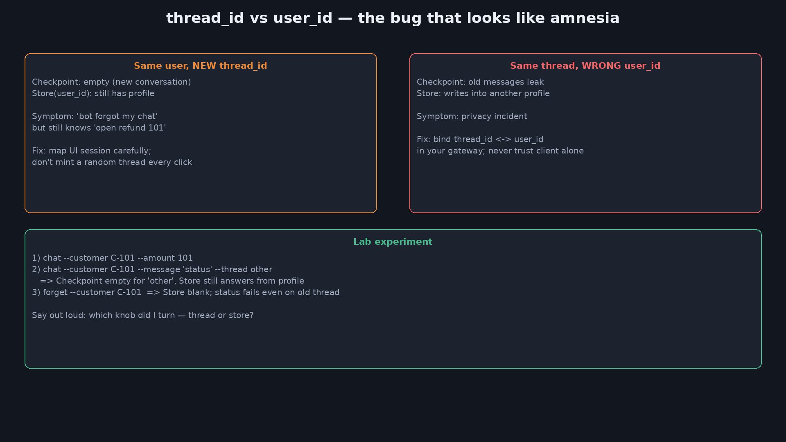
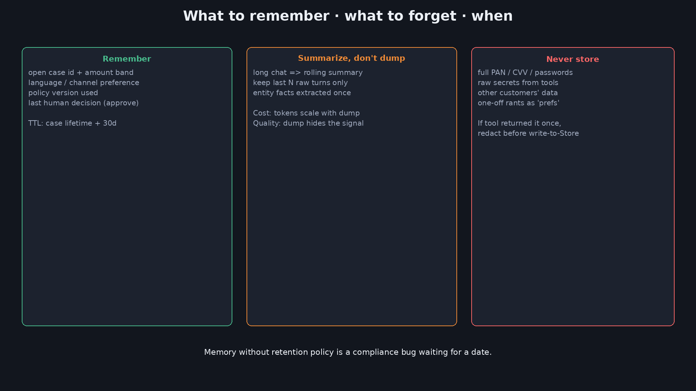
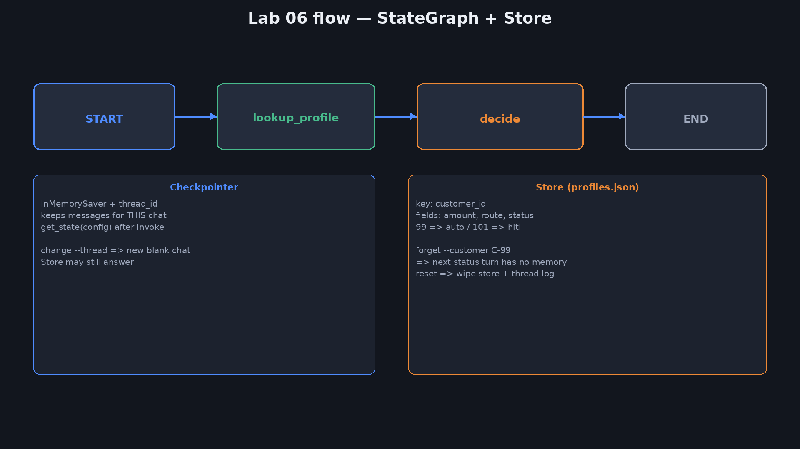

<div dir="rtl" lang="he">

<p align="center">
  
</p>

# ‏מפגש 6 — מצגת סטודנטים
## ‏Memory ו-State Management

> **משך משוער:** ~2–2.5 שעות (הדגמת פתיחה + הוראה + Lab + הדגמות).  
> נפתח בהדגמה פשוטה בלי API — ואז Lab עם כפתורים שמשנים תוצאה בין הרצות.  
> חזרה קצרה על Checkpoint (מפגש 4) ו-context (מפגש 5).

---

# ‏חלק א׳ — פתיחה והדגמה

_רואים בלי זיכרון ועם Store, ואז מפרקים_

## ‏1 — כותרת

> פתיחה — Memory מול State

<p align="center">
  
</p>

**‏Memory ו-State Management**  
מה הסוכן זוכר, לכמה זמן, ומה אסור לו לשמור



---

## ‏2 — הדגמת פתיחה — בלי זיכרון / עם Store

תיקייה: `demos/06-memory-opening/`

```bash
cd demos/06-memory-opening
python3 memory_opening.py --mode none --amount 99
python3 memory_opening.py --reset
python3 memory_opening.py --mode store --customer C-99 --amount 99
python3 memory_opening.py --mode store --customer C-99 --status
python3 memory_opening.py --mode store --customer C-101 --amount 101
python3 memory_opening.py --show
```

- ‏99 → `auto` · 101 → `hitl` · אותו קוד, קלט שונה  
- ‏`out/profiles.json` = Memory בין ריצות (לא Checkpoint)

---

## ‏3 — מה ראינו — פירוק

| מה ראינו | מושג |
|---|---|
| תור 2 בלי קובץ מתחיל מאפס | אין **Memory** בין ריצות |
| ‏`profiles.json` זוכר amount/route/status | ‏**Store** / פרופיל ישות |
| ‏99→auto · 101→hitl | מדיניות על זיכרון עסקי, לא על צ׳אט |
| זה לא `thread_id` | ‏**Checkpoint** (מפגש 4) = מצב *בתוך* ריצה |

הדגמה זו במכוון בלי LLM — כדי שלא נבלבל "המודל זכר" עם "שמרנו עובדה".

---

## ‏4 — מה היום (+ חזרה קצרה)

| נבנה היום | כבר למדנו |
|---|---|
| ‏Checkpoint מול Memory / Store | מפגש 4: Checkpointer · thread_id · interrupt |
| שכבות זיכרון · שמירה/מחיקה | מפגש 5: context בין משימות בצוות |
| ‏Lab: גרף + profiles.json | מפגש 3: כלים / תצפיות |

יעד משך: **~2–2.5 שעות** (קצר ממפגש 5 בפועל).

---

## ‏5 — שאלת המפגש + תוצרים

> מה הסוכן צריך לזכור מחר על הלקוח — ומה **אסור** לו לזכור?

בסוף תדעו:
1. להסביר Checkpoint מול Memory במשפט אחד  
2. לבחור שכבת זיכרון (State / Thread / Store / RAG)  
3. להריץ Lab עם `--amount` / `--thread` / `forget` ולנבא את התוצאה  
4. לכתוב כלל שמירה: מה, כמה זמן, מתי מוחקים

---

# ‏חלק ב׳ — מושגים

_שכבות, מפתחות, ומה לא לשמור_

## ‏6 — מילון

| מונח | בעברית פשוטה |
|---|---|
|‏ **Checkpoint** | צילום מצב הריצה — להמשך / HITL |
|‏ **thread_id** | מזהה שיחה או ריצה ל-Checkpointer |
|‏ **Store / Memory** | זיכרון בין ריצות — פרופיל, העדפות, תיק פתוח |
|‏ **user_id / customer_id** | מפתח לישות בעולם האמיתי |
|‏ **Working memory** | מה ב-State / בהקשר *עכשיו* |
|‏ **TTL / Retention** | כמה זמן שומרים לפני מחיקה |
|‏ **RAG** | שליפה ממאגר ואז יצירה (לא "זיכרון אישי") |
|‏ **HITL** | אדם בלולאה (מפגש 4) |

---

## ‏7 — Checkpoint מול Memory


| | Checkpoint | Memory / Store |
|---|---|---|
| מפתח |‏ `thread_id` |‏ `user_id` / `customer_id` |
| חיים | ריצה / שיחה | ימים־חודשים (לפי מדיניות) |
| כשל בלי זה | אין resume ל-HITL | כל סשן מתחיל מאפס |

---

## ‏8 — ארבע שכבות זיכרון



1. ‏Working / State — שדות הריצה  
2. ‏Thread / Checkpoint — messages לפי thread_id  
3. ‏Profile / Entity Store — פרופיל לפי user_id  
4. ‏Long-term / RAG — מסמכים ושליפה  

בוחרים את **השכבה הנמוכה ביותר** שפותרת את הצורך.

---

## ‏9 — thread_id מול user_id



- אותו משתמש + `thread_id` חדש → Checkpoint ריק, Store עדיין יודע  
- אותו thread + `user_id` שגוי → דליפת פרטיות  

ב-Lab: `--thread other` מול `forget --customer …`

---

## ‏10 — מה לזכור · מה לשכוח



| לזכור | לסכם | לא לשמור |
|---|---|---|
| תיק פתוח, סכום/מסלול | צ׳אט ארוך → סיכום |‏ PAN / סיסמאות / סודות |
| שפת ממשק | ‏N הודעות אחרונות גולמיות | נתוני לקוח אחר |
| החלטת אדם אחרונה | עובדות ישות מחולצות | רכילות חד־פעמית כ"העדפה" |

---

## ‏11 — Buffer מול Summary

```text
Buffer:  [u1,a1,u2,a2, … u40,a40]  → יקר, מדויק לטווח קצר
Summary: [SUMMARY(u1..u30), u31,a31, …] → זול יותר, מאבד ניואנס
```

כלל מעשי: אחרי N תורות — מסכמים, משאירים רק את החלון האחרון גולמי.
ב-Store שומרים **עובדות מחולצות**, לא את כל ה-buffer.

---

# ‏חלק ג׳ — בגרף ובמוצר

‏_Checkpointer, Store, ומדיניות_

## ‏12 — Memory ≠ RAG

| | Memory / Store | RAG |
|---|---|---|
| שאלה | מה אנחנו יודעים על *המשתמש הזה*? | איזה *מסמך* רלוונטי? |
| מפתח | user_id | שאילתה / embedding |
| דוגמה | "יש לך החזר 101 ב-pending" | "סעיף 3 במדיניות החזרים" |

אפשר לשלב: Store אומר שיש תיק פתוח; RAG מצטט את המדיניות.

---

## ‏13 — Checkpointer — חזרה קצרה + חידוד

```python
from langgraph.checkpoint.memory import InMemorySaver
app = graph.compile(checkpointer=InMemorySaver())
config = {"configurable": {"thread_id": "thread-C-99"}}
app.invoke(state, config)
app.get_state(config)   # snapshot של State + messages
```

- בלי checkpointer — אין resume אמיתי (מפגש 4)  
- ‏`InMemorySaver` נעלם עם תהליך חדש · בפרוד: Sqlite / Postgres  

---

## ‏14 — Store בפועל (Lab)



```text
START → lookup_profile(Store) → decide(write/read Store) → END
         + Checkpointer(thread_id) על messages
```

קבצים: `data/profiles.json` · לוג `data/checkpoints.sqlite`

---

## ‏15 — פרטיות ואבטחה

- מצמידים `thread_id` ל-`user_id` בשרת — לא סומכים רק על הלקוח  
- עורכים תצפיות כלים לפני כתיבה ל-Store  
- ‏TTL + `forget` / מחיקה לפי בקשת משתמש (GDPR-ish)  
- לוגים: לא מדפיסים סודות; כן מדפיסים customer_id ו-route

---

## ‏16 — Anti-Patterns

1. ‏`memory=True` / Store בלי לדעת *מה* נשמר  
2. ‏Buffer אינסופי בלי Summary  
3. ‏thread_id חדש בכל בקשת HTTP  
4. לערבב RAG עם פרופיל משתמש באותה מפה  
5. לשמור סודות "רק לדיבאג"  
6. ‏Checkpoint בזיכרון תהליך בפרוד serverless בלי Store חיצוני

---

# ‏חלק ד׳ — Lab

_מריצים, משנים קלט, מנבאים תוצאה_

## ‏17 — Checklist

- [ ] יש הפרדה מפורשת: Checkpoint מול Store  
- [ ] לכל Store יש מפתח ישות + TTL  
- [ ] יש `forget` / מחיקה  
- [ ] ‏thread_id לא אקראי לכל קליק  
- [ ] אין סודות ב-Store / בלוגים  
- [ ] אפשר להריץ תרחיש 99 ו-101 ולנבא route

---

## ‏18 — Lab — מטרה

תיקייה: [`labs/06-memory-state/`](labs/06-memory-state/)

| חלק | מה |
|---|---|
| Checkpointer |‏ `InMemorySaver` + `thread_id` |
| Store |‏ `data/profiles.json` לפי customer |
| כפתורים |‏ `--amount` · `--message` · `--thread` · `forget` · `reset` |

בלי מפתח LLM. מודדים: האם ניחשתי נכון מה יקרה אחרי השינוי.

---

## ‏19 — Lab — מה נריץ

```bash
cd labs/06-memory-state
python3 -m venv .venv && source .venv/bin/activate
pip install -r requirements.txt

python3 memory_lab.py reset
python3 memory_lab.py chat --customer C-99 --amount 99
python3 memory_lab.py chat --customer C-99 --message "מה הסטטוס?"
python3 memory_lab.py chat --customer C-101 --amount 101
python3 memory_lab.py chat --customer C-101 --message "מה הסטטוס?" --thread other
python3 memory_lab.py forget --customer C-99
python3 memory_lab.py chat --customer C-99 --message "מה הסטטוס?"
python3 memory_lab.py show
```

---

## ‏20 — Lab — Debrief

- [ ] אני יודע מתי התשובה באה מ-Store ומתי מ-Checkpoint  
- [ ] ניחשתי נכון מה יעשה `--thread other`  
- [ ] אחרי `forget` — רק הלקוח שנמחק נפגע  
- [ ] שינוי 99↔101 משנה route בלי שינוי קוד

---

# ‏חלק ה׳ — הדגמות פתרון וסיכום

_באגים, Design Review, שיעורי בית_

## ‏21 — הדגמה — שינויים שמשנים תוצאה

| שינוי | תוצאה צפויה |
|---|---|
|‏ `--amount 50` במקום 99 | עדיין auto (מתחת לסף) |
|‏ `--amount 250` | hitl |
|‏ `forget` ואז status | "אין לי זיכרון" |
|‏ אותו customer, שני threads | ‏Store משותף · Checkpoint נפרד |
|‏ `reset` | הכל ריק |

המסר: Memory טוב הוא **כפתור שניתן לסובב בהדגמה** — לא קסם חד־פעמי.

---

## ‏22 — הדגמה — באג: thread חדש כל פעם

סימפטום: "הבוט לא זוכר את מה שכתבתי לפני דקה".  
סיבה: ה-gateway יצר `thread_id` חדש; Checkpoint ריק.  
בדיקה: Store עדיין יודע על החזר פתוח → הזיכרון העסקי חי, זיכרון השיחה מת.  
תיקון: יציבות thread לפי סשן משתמש; לא `uuid4()` לכל הודעה.

---

## ‏23 — Design Review — זיכרון לתמיכה

הצעה: "נשמור את כל היסטוריית הצ׳אט לכל הלקוחות ב-vector DB אחד, בלי TTL."

| שאלה | החלטה |
|---|---|
| מה חייב Store? | תיק פתוח, מסלול, העדפת שפה |
| מה Buffer/Summary? | שיחה נוכחית בלבד |
| מה RAG? | מדיניות ומדריכים — לא פרופיל |
| TTL? | תיק: +30 יום אחרי סגירה |
| מחיקה? | ‏API `forget` + בקשת משתמש |

---

## ‏24 — סיכום

- Checkpoint ≠ Memory  
- ארבע שכבות — בוחרים נמוך כשאפשר  
- מפתחות: thread_id מול user_id  
- ‏Retention: לזכור / לסכם / לא לשמור  
- ‏Lab: שינוי קלט → תוצאה אחרת  
- במפגש הבא: **Agents לאוטומציה עסקית**

---

## ‏25 — הכנה למפגש 7

- חשבו על תהליך עסקי אחד אצלכם (החזר, onboarding, חשבונית)  
- סמנו: איפה State, איפה Store, איפה HITL  
- שאלה: מה האוטומציה חוסכת — ומה היא עלולה לשבור?

---

## ‏26 — תרגיל בית

1. הוסיפו ל-Lab שדה `reason` ב-Store ונסו status אחרי בקשה  
2. ממשו TTL מדומה: אם `status=approved` יותר מ-X הרצות — `forget` אוטומטי  
3. כתבו 5 שורות מדיניות: מה אסור לשמור במוצר שלכם  
4. בונוס: החליפו `profiles.json` ב-SQLite עם אותן פקודות CLI

</div>
