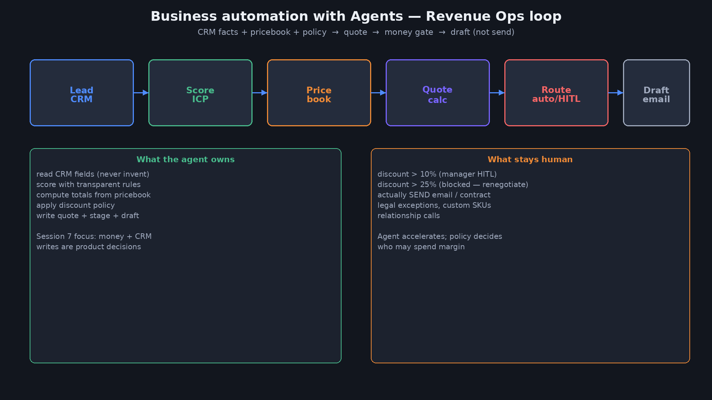
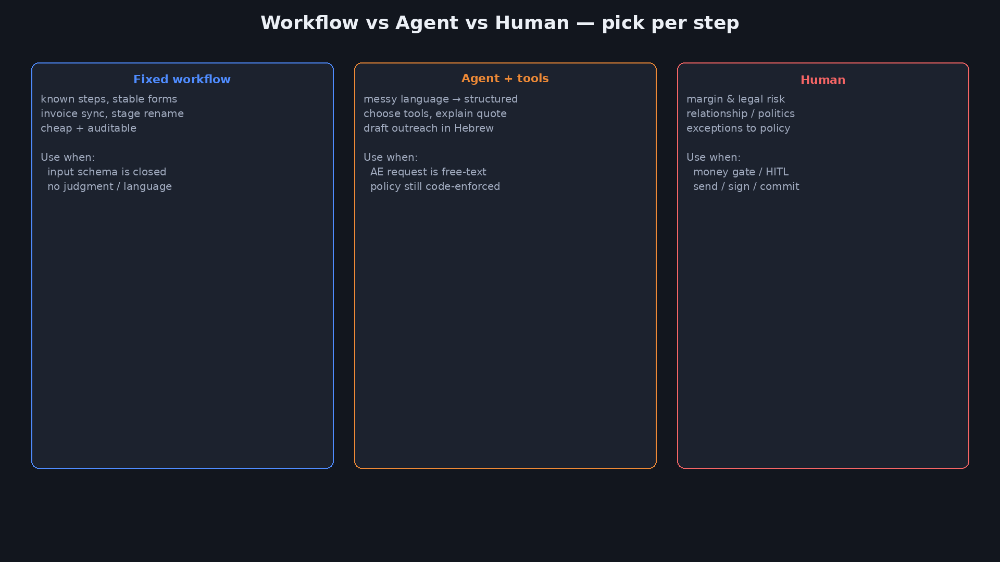
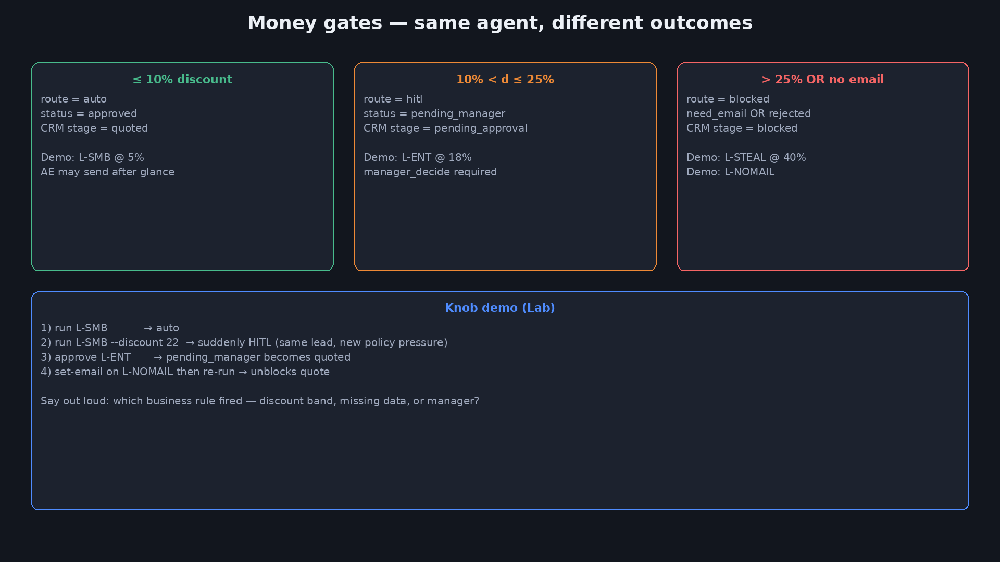
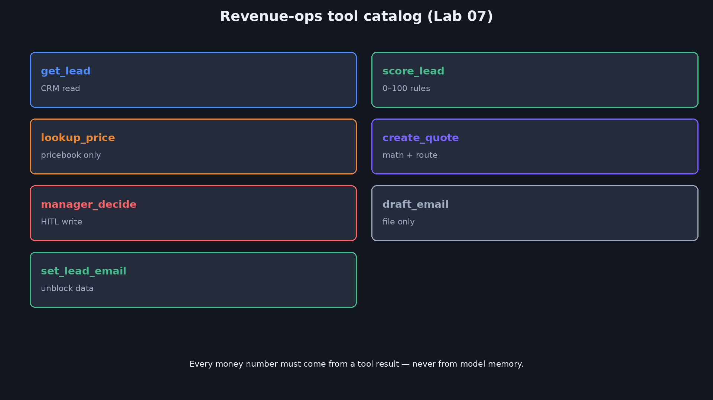
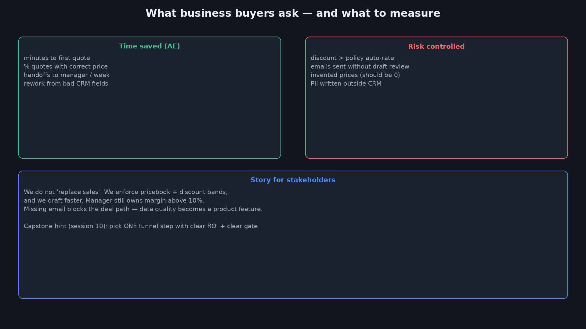

<div dir="rtl" lang="he">

<p align="center">
  
</p>

# ‏מפגש 7 — מצגת סטודנטים
## ‏Agents לאוטומציה עסקית

> **משך משוער:** ~2.5–3.5 שעות (הדגמת פתיחה + הוראה + Lab עשיר + Design Review).  
> נפתח במילון עסקי, ואז Sales Ops ב-Claude Code/Cursor — CRM → הצעת מחיר → שער כסף.  
> Lab עם `ANTHROPIC_API_KEY` + `sales_claude.py` ותרחישי SMB / Enterprise / Upsell / Blocked.  
> **תדריך מנהלים (High Level):** [`07-exec-briefing.md`](07-exec-briefing.md)  
> חזרה קצרה: כלים (3) · צוות (5) · Memory/Store (6).

---

# ‏חלק א׳ — פתיחה והדגמה

_סוכן מכירות רץ על לידים אמיתיים-למחצה_

## ‏1 — כותרת

> פתיחה — אוטומציה עסקית עם Agents

<p align="center">
  
</p>

**‏Agents לאוטומציה עסקית**  
מליד להצעת מחיר — עם מדיניות הנחה, CRM, וטיוטת מייל (בלי לשלוח)



---

## ‏2 — מילון עסקי למפגש

> מילון — לפני ההדגמה, כדי ש־SMB / HITL / Quote יהיו ברורים

| מונח | הסבר |
|---|---|
| ‏**Lead (ליד)** | פנייה/הזדמנות במכירות לפני סגירה — אצלנו רשומה ב-CRM (`L-SMB`, `L-ENT`…) |
| ‏**CRM** | מערכת ניהול לקוחות/הזדמנויות; כאן קובץ `leads.json` עם stage ופרטי חברה |
| ‏**Stage** | שלב במשפך ב-CRM: `new` · `quoted` · `pending_approval` · `blocked` |
| ‏**Sales Ops** | תפעול מכירות: תהליכים, כלים ומדיניות סביב AE — לא רק "שיחת מכירה" |
| ‏**Revenue Ops / RevOps** | חיבור מכירות·שיווק·הצלחת לקוח סביב דאטה, תהליך ומדדים |
| ‏**AE** | Account Executive — בעל העסקה; מי שאנחנו מאיצים (לא מחליפים) |
| ‏**ICP** | Ideal Customer Profile — מי נחשב ליד מתאים (סגמנט, תקציב, דחיפות) |
| ‏**SMB / Enterprise** | גודל לקוח: עסק קטן-בינוני מול ארגון גדול (אצלנו גם תרחישי Lab שונים) |
| ‏**SKU** | קוד מוצר במחירון (`starter` / `pro` / `enterprise`) |
| ‏**Seats (מושבים)** | יחידות רישוי/משתמשים לחיוב חודשי |
| ‏**Pricebook / מחירון** | מקור האמת למחיר ליחידה — אסור להמציא מחיר מהמודל |
| ‏**List price** | מחיר מחירון לפני הנחה |
| ‏**Quote** | הצעת מחיר שמורה (`quotes.json`) עם סכום, הנחה, route ו-status |
| ‏**Discount gate / שערי כסף** | ספי הנחה שמפעילים auto / HITL / blocked לפי מדיניות |
| ‏**מרווח (margin)** | הרווח שעלול להישחק בהנחה גבוהה בלי אישור |
| ‏**HITL** | Human-in-the-loop — אדם חייב לאשר (כאן: מנהל מעל סף הנחה) |
| ‏**route** | מסלול החלטה: `auto` · `hitl` · `blocked` |
| ‏**status** | מצב ההצעה: `approved` · `pending_manager` · `rejected` · `need_email` |
| ‏**Upsell** | הצעה ללקוח **קיים** (שדרוג SKU) — לא לוגו חדש |
| ‏**Outbound** | פנייה יזומה ללקוחות/לידים (מיילים, הגעה); מסוכן בלי ביקורת |
| ‏**Draft ≠ Send** | טיוטת מייל לקובץ ≠ שליחה אמיתית (כלי מסוכן נפרד) |
| ‏**Audit log** | יומן פעולות (quote / approve) לבקרה ו-compliance |
| ‏**ROI** | החזר על השקעה — מדדים שמשכנעים הנהלה (זמן AE, מרווח, דאטה) |
| ‏**פיילוט** | ניסוי מוגבל לפני פריסה רחבה; דורש checklist ומדדים |
| ‏**בעלי עניין** | AE, מנהל מכירות, RevOps, הנהלה — כל אחד עם מדד אחר |
| ‏**Guardrails** | מגבלות בטיחות לסוכן (מחיר מ-pricebook, אין המצאת אימייל…) |
| ‏**Anti-pattern** | דפוס נפוץ שנשבר בפרודקשן (למשל "המודל יודע את המחירון") |
| ‏**Design Review** | סקירת הצעת מוצר מול סיכונים ומדיניות לפני בנייה |
| ‏**Workflow** | תהליך קבוע עם קלט סגור — בלי שיפוט שפתי של מודל |
| ‏**RACI** | מי Responsible / Accountable / Consulted / Informed בכל שלב במשפך |
| ‏**PII** | מידע מזהה אישית — נשאר ב-CRM, לא בלוגים חופשיים |
| ‏**מקור אמת למחיר** | רק pricebook/כלי `lookup_price` — לא פרומפט ולא זיכרון מודל |
| ‏**ציון ליד (score)** | ניקוד שקוף לתעדוף AE — **לא** מחליף שערי הנחה |
| ‏**Allowlist** | רשימת מורשים (למשל מי/מה מורשה `send`) |

---

## ‏3 — הדגמת פתיחה — Claude Code + Sales Ops

תיקייה: `demos/07-sales-opening/` · מומלץ **Claude Code** (או Cursor · `prompt-cursor.md`)

```bash
cd demos/07-sales-opening
./run-claude.sh reset
./run-claude.sh smb           # L-SMB / 5% → auto
./run-claude.sh enterprise    # L-ENT / 18% → hitl (שומר L-SMB)
./run-claude.sh nomail        # L-NOMAIL → need_email
cat out/quotes.json
```

**מאיפה מגיעים 5% ו-18%?** (לא מהסקריפט — מה-CRM)

| מה | איפה בקובץ | דוגמה |
|---|---|---|
| הנחה שמבקשים לליד | `crm/leads.json` → שדה `requested_discount_pct` | ‏`L-SMB`: **5** · `L-ENT`: **18** |
| ספי אישור (מתי auto/HITL) | `policy.md` → Discount & approval | ‏≤10% auto · ≤25% HITL · >25% blocked |
| מחיר ליחידה (SKU) | `policy.md` → Pricing | Pro=299 · Enterprise=799 |

לשנות תרחיש: ערכו `requested_discount_pct` ב-`crm/leads.json` (או ב-`crm/leads.seed.json` ואז `./run-claude.sh reset`) — **בלי** לגעת ב-`run-claude.sh`.  
תוצרים: `out/quotes.json` · טיוטה ב-`out/email_draft.md`.  

---

## ‏4 — מה ראינו — פירוק

| מה ראינו | מושג עסקי |
|---|---|
| מספרים מ-pricebook ולא מהמודל | מקור אמת למחיר |
| ‏5% / 18% מ-`requested_discount_pct` ב-CRM; ספים מ-`policy.md` | **שער כסף** (discount gate) |
| בלי מייל — חסימה, לא המצאה | איכות דאטה כחלק מהמוצר |
| ‏`email_draft.md` בלי "נשלח" | טיוטה ≠ פעולה מסוכנת |
| ‏L-SMB נשמר כשעובדים על L-ENT | Store/CRM בין תורות (מפגש 6) |

---

## ‏5 — מה היום (+ חזרה קצרה)

| נבנה היום | כבר למדנו |
|---|---|
| משפך מכירות כסוכן + כלים | מפגש 3: schema · validate · observations |
| שערי HITL על הנחה / כסף | מפגש 4: interrupt · checkpoint |
| ציון ליד · Upsell · audit | מפגש 5: תפקידים בצוות |
| Lab עם כפתורים שמשנים עסקה | מפגש 6: Store מול Checkpoint |

יעד משך: **~2.5–3.5 שעות** (קצת ארוך ממפגש 6 — יותר תרחישים עסקיים).

---

## ‏6 — שאלת המפגש + תוצרים

**שאלה:** איפה Agent מוסיף ערך בעסק — ואיפה הוא חייב לעצור בפני מדיניות/אדם?

| תוצר | הגדרת "עובד" |
|---|---|
| מפת תהליך | לכל שלב: workflow / agent / human |
| קטלוג כלים | CRM · מחיר · הצעה · HITL · טיוטה |
| Lab רץ | לפחות 4 תוצאות שונות מאותו קוד |
| סיפור לבעלי עניין | זמן AE + סיכון מרווח |

---

# ‏חלק ב׳ — מסגרת עסקית

_לא צ׳אטבוט — מערכת שמזיזה עסקאות_

## ‏7 — אוטומציה עסקית ≠ בוט שיחה

| בוט שיחה | Agent עסקי |
|---|---|
| עונה על שאלות | משנה **מצב מערכת** (CRM stage, quote) |
| הצלחה = תשובה נחמדה | הצלחה = הצעה נכונה + מסלול מדיניות |
| סיכון: טקסט גרוע | סיכון: הנחה לא מאושרת / מחיר בדוי |



---

## ‏8 — מתי Workflow, מתי Agent, מתי אדם

| סוג | דוגמה במכירות | למה |
|---|---|---|
| ‏**Workflow** | סנכרון חשבונית, שינוי stage קבוע | קלט סגור, בלי שיפוט |
| ‏**Agent + tools** | "תכין הצעה לליד הזה בעברית" | שפה חופשית → מבנה |
| ‏**Human** | הנחה 18%, חתימה, שליחת חוזה | מרווח / סיכון משפטי |

כלל: **המדיניות בקוד/כלים; השפה אצל המודל.**

---

## ‏9 — משפך Sales Ops כלולאת Agent


1. קריאת ליד מ-CRM  
2. ציון (ICP / תקציב / דחיפות)  
3. מחירון  
4. חישוב הצעה  
5. ניתוב auto / HITL / blocked  
6. טיוטת מייל (לא שליחה)

---

# ‏חלק ג׳ — מדיניות, כלים, סיכונים

_איך בונים סוכן שמנהלי מכירות סומכים עליו_

## ‏10 — שערי כסף (Money Gates)



| הנחה | מסלול | stage ב-CRM |
|---|---|---|
| ‏≤ 10% | `auto` / approved | `quoted` |
| ‏≤ 25% | `hitl` / pending_manager | `pending_approval` |
| ‏> 25% | `blocked` / rejected | `blocked` |
| אין email | `blocked` / need_email | `blocked` |

---

## ‏11 — קטלוג כלים ל-Revenue Ops



```
get_lead → score_lead → lookup_price → create_quote → draft_email
                              ↓
                     (אם hitl) manager_decide
```

כל מספר כספי חייב להגיע מתוצאת כלי — לא מזיכרון המודל.

---

## ‏12 — ציון ליד בלי קסם

דוגמה שקופה (Lab):

| אות | נקודות (דוגמה) |
|---|---|
| תקציב high/medium/low | 40 / 25 / 10 |
| דחיפות rfp / quarter / exploring | 35 / 20 / 5 |
| סגמנט enterprise / mid / smb | 30 / 20 / 10 |
| לקוח קיים | +15 |
| יש אימייל | +10 · אין → −20 |

ציון עוזר ל-AE לתעדף — **לא מחליף** את שערי ההנחה.

---

## ‏13 — מחזור חיים של Quote

```
new → (quote) → quoted | pending_approval | blocked
                      ↓ approve
                   quoted
                      ↓ reject
                   blocked
```

- ‏`pending_manager` בלי `manager_decide` = עסקה תקועה (נכון!)  
- אסור לסמן "approved" בטיוטת מייל לפני אישור

---

## ‏14 — היגיינת כתיבה ל-CRM

| מותר | אסור |
|---|---|
| עדכון `stage`, `score`, הנחה מבוקשת | למחוק היסטוריית עסקה בשקט |
| לכתוב note קצר באנגלית/עברית | להמציא אימייל / ח.פ. / תקציב |
| לשמור quote נפרד לקובץ/טבלה | לדרוס לידים אחרים באותה כתיבה |

---

## ‏15 — טיוטת מייל ≠ שליחה

```text
draft_email → כותב data/email_draft.md · sent=false
send_email  → (לא קיים ב-Lab בכוונה) · דורש הרשאה + לוג + לעיתים HITL
```

מסר לבעלי עניין: "הסוכן מאיץ ניסוח; האדם (או כלי נפרד מבוקר) שולח."

---

## ‏16 — Guardrails לסוכני מכירות

- [ ] מחיר רק מ-pricebook  
- [ ] הנחה מחוץ לסף לא יכולה להיות `approved` בלי מנהל  
- [ ] אין המצאת אימייל / אנשי קשר  
- [ ] אין `send` באותו כלי שעושה `draft`  
- [ ] audit log לכל quote / approve  
- [ ] PII נשאר ב-CRM — לא בלוגים חופשיים

---

## ‏17 — Anti-Patterns

| אנטי־דפוס | למה נשבר |
|---|---|
| "המודל יודע את המחירון" | מחיר ישן / מומצא |
| הנחה אוטומטית לכל Enterprise | שחיקת מרווח |
| שליחת מייל באותה קריאת כלי | אין ביקורת AE |
| ליד בלי מייל → המצאה | ספאם + אמון |
| צוות 5 סוכנים לפני מדיניות אחת | רעש בלי שליטה |

---

## ‏18 — Checklist לפני פיילוט מכירות

- [ ] יש מקור אמת למחיר  
- [ ] יש ספי הנחה כתובים בקוד/מדיניות  
- [ ] יש HITL מנהל מעל הסף  
- [ ] יש חסימה לנתונים חסרים  
- [ ] טיוטה מופרדת משליחה  
- [ ] אפשר להריץ SMB מול ENT ולנבא route  
- [ ] יש סיפור ROI ל-AE ולמנהל (שקף 25)

---

# ‏חלק ד׳ — Lab

_אותו קוד — חמש תוצאות עסקיות_

## ‏19 — Lab — מטרה

תיקייה: [`labs/07-business-automation/`](labs/07-business-automation/)

דורש **`ANTHROPIC_API_KEY`** · קובץ: `sales_claude.py`

לידים: `L-SMB` · `L-ENT` · `L-NOMAIL` · `L-UPSELL` · `L-STEAL`  
כפתורים בהודעה: הנחה אחרת · אישור/דחיית מנהל · השלמת אימייל · `--fresh-thread`

---

## ‏20 — Lab — מה נריץ

```bash
cd labs/07-business-automation
python3 -m venv .venv && source .venv/bin/activate
pip install -r requirements.txt
export ANTHROPIC_API_KEY=sk-ant-...

python3 sales_claude.py reset
python3 sales_claude.py chat --lead L-SMB --message "תכין הצעת מחיר לפי הליד"
python3 sales_claude.py chat --lead L-ENT --message "תכין הצעה עם ההנחה המבוקשת"
python3 sales_claude.py chat --lead L-ENT --message "מנהל מאשר את ההצעה"
python3 sales_claude.py chat --lead L-NOMAIL --message "תכין הצעה"
python3 sales_claude.py chat --lead L-STEAL --message "הלקוח רוצה 40 אחוז — תוציא הצעה"
python3 sales_claude.py chat --lead L-UPSELL --message "תכין הצעת שדרוג ללקוח קיים"
python3 sales_claude.py show
```

---

## ‏21 — Lab — Debrief

- [ ] ניחשתי נכון route ל-SMB / ENT / STEAL  
- [ ] אחרי approve — ENT עבר ל-`quoted`  
- [ ] NOMAIL נחסם עד שיש אימייל  
- [ ] UPSELL מסומן `upsell=true`  
- [ ] ראיתי `TOOL ->` בלוג — לא ניחוש

---

# ‏חלק ה׳ — הדגמות, ערך עסקי, סיכום

## ‏22 — הדגמה — כפתורים שמשנים עסקה

| שינוי (ב-`sales_claude.py chat`) | תוצאה צפויה |
|---|---|
| ‏`L-SMB` + הצעה רגילה (5%) | auto |
| ‏`L-SMB` + "עם 22 אחוז הנחה" | hitl (אותו ליד!) |
| ‏`L-ENT` + "מנהל מאשר" | pending → quoted |
| ‏`L-ENT` + "מנהל דוחה" | blocked |
| ‏`L-NOMAIL` ואז "המייל הוא … עדכן והכן הצעה" | auto אפשרי |
| ‏`L-STEAL` (40%) | rejected תמיד |

---

## ‏23 — הדגמה — באג: "הסוכן המציא מחיר"

סימפטום: הצעה עם 250 ₪ ל-Pro במקום 299.  
סיבה: המודל לא קרא `lookup_price` / pricebook ישן בקונטקסט.  
בדיקה: בלוג אין `TOOL -> lookup_price`.  
תיקון: חובת כלי לפני `create_quote`; validate שה-sku קיים; אל תשימו מחירון בפרומפט בלבד.

---

## ‏24 — Design Review — "נאוטומט את כל ה-Outbound"

הצעה: סוכן שולח מיילים לכל ליד חדש עם הנחה "גמישה עד 20%".

| שאלה | החלטה מומלצת |
|---|---|
| מי שולח? | אדם או כלי `send` נפרד עם allowlist |
| מה ההנחה המקסימלית בלי מנהל? | ‏≤10% |
| מה אם אין אימייל מאומת? | חסימה |
| איך מודדים הצלחה? | תשובות / פגישות — לא "מיילים שנשלחו" |
| מה ב-audit? | lead_id, discount, route, timestamp |

---

## ‏25 — ROI ומדדים לבעלי עניין



| ל-AE | למנהל מכירות | ל-RevOps |
|---|---|---|
| דקות להצעה ראשונה | % עסקאות מעל סף בלי HITL (צריך → 0) | שלמות שדות CRM |
| פחות העתקה ממחירון | מרווח מוגן | audit מלא |

משפט לסיכום פגישת הנהלה:  
**לא מחליפים מכירות — מאלצים מחירון וספי הנחה, ומאיצים טיוטות.**

---

## ‏26 — מיני־מקרה: שלושה לידים בבוקר אחד

| ליד | מה הסוכן עושה | מה האדם עושה |
|---|---|---|
| ‏SMB 5% | quote + draft | AE שולח אחרי מבט |
| ‏ENT 18% | quote + pending | מנהל מאשר/דוחה |
| בלי מייל | blocked | AE ממלא אימייל ב-CRM |

אותו קוד — שלושה תפקידים ארגוניים.

---

## ‏27 — סיכום

- אוטומציה עסקית = שינוי מצב מערכת + מדיניות  
- Workflow / Agent / Human — בחירה לכל שלב  
- שערי כסף + איכות דאטה חשובים כמו ה-LLM  
- טיוטה ≠ שליחה  
- Lab: כפתור אחד → עסקה אחרת  
- במפגש הבא: **Cursor · Claude Code · משטחי פלט (HTML / Telegram)**

---

## ‏28 — הכנה למפגש 8

- חשבו איפה המשתמש רואה תוצר סוכן אצלכם (UI / טלגרם / מייל)  
- סמנו: מה טיוטה ומה שליחה אמיתית  
- שאלה: האם AE יכול להבין הצעה בלי לפתוח לוג?

---

## ‏29 — תרגיל בית

1. הוסיפו SKU חדש ל-pricebook והריצו ליד שמתעניין בו  
2. שנו את סף ה-HITL מ-10% ל-15% — תעדו איזה ליד "זז"  
3. כתבו טבלת RACI: מי AE / מנהל / סוכן / RevOps לכל שלב במשפך  
4. בונוס: חברו `sales_claude.py` לכתיבת שורת CSV audit נוספת בכל `create_quote`

---

## ‏30 — נספח מהיר — כפתורים ב-Anthropic

```bash
python3 sales_claude.py reset
python3 sales_claude.py chat --lead L-SMB --message "תכין הצעת מחיר לפי הליד"
python3 sales_claude.py chat --lead L-SMB --message "תכין שוב עם 22 אחוז הנחה" --fresh-thread
python3 sales_claude.py chat --lead L-ENT --message "תכין הצעה עם ההנחה המבוקשת"
python3 sales_claude.py chat --lead L-ENT --message "מנהל מאשר את ההצעה"
python3 sales_claude.py chat --lead L-NOMAIL --message "תכין הצעה"
python3 sales_claude.py chat --lead L-NOMAIL --message "המייל הוא hero@startup.co.il — עדכן והכן הצעה"
python3 sales_claude.py chat --lead L-STEAL --message "הלקוח רוצה 40 אחוז — תוציא הצעה"
python3 sales_claude.py chat --lead L-UPSELL --message "תכין הצעת שדרוג ללקוח קיים"
python3 sales_claude.py show
```

</div>
