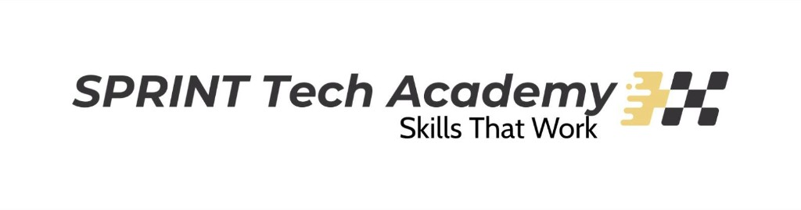
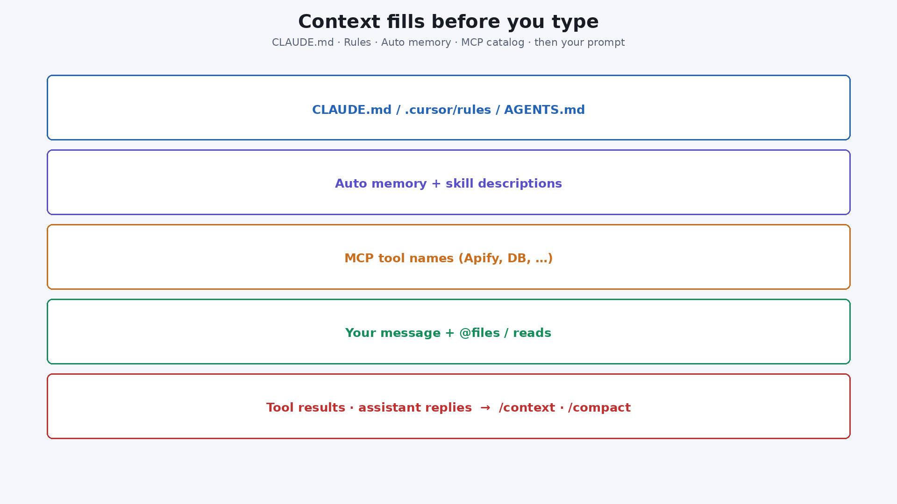
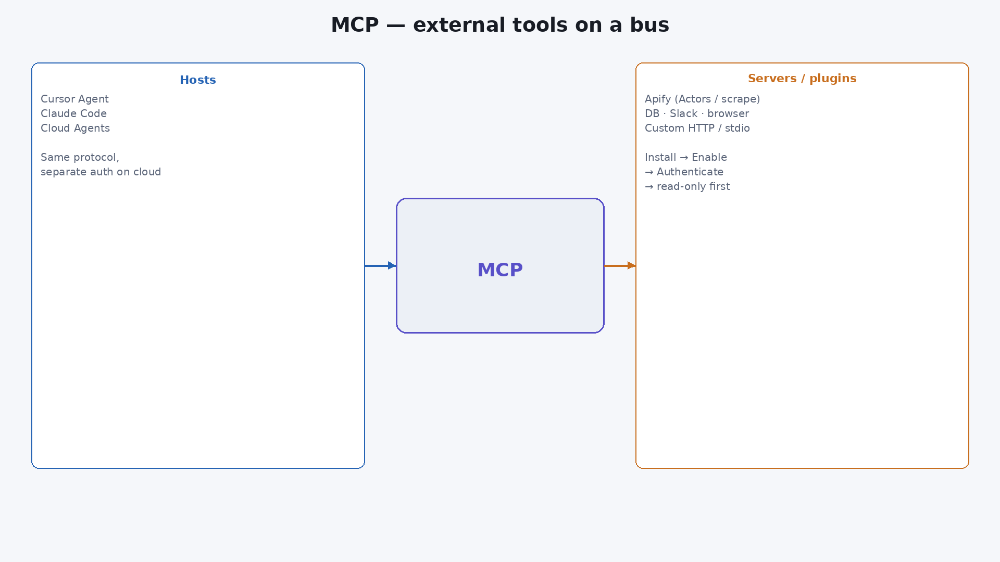
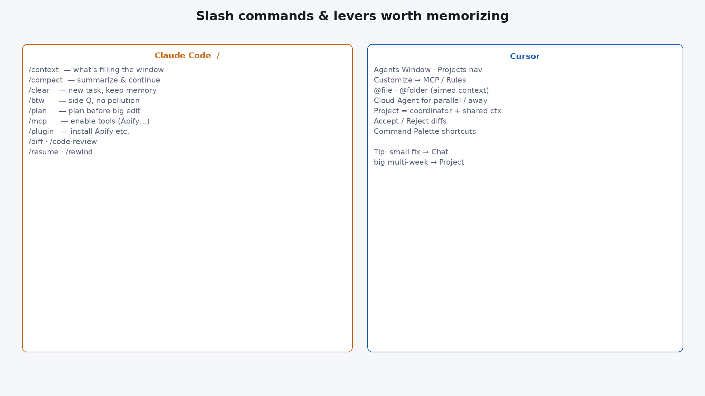
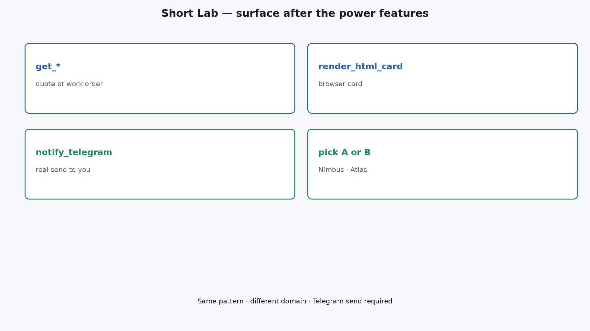

<div dir="rtl" lang="he">

<p align="center">
  
</p>

# ‏מפגש 8 — מצגת סטודנטים
## ‏סודות Cursor · Claude Code · Cloud · MCP

> דגש: קונטקסט, Rules מול Skills, גודל חלון, MCP, Chat·Cloud·Projects.  
> Lab קצר בסוף: HTML + טלגרם.  
> תדריך מנהלים: [`08-exec-briefing.md`](08-exec-briefing.md) · תסריט מרצה מורחב: [`08-cursor-claude-surfaces.md`](08-cursor-claude-surfaces.md)

---

# ‏חלק א׳ — מה מסתתר מאחורי המסך

## ‏1 — כותרת

> פתיחה — Power features שמשנים את העבודה

<p align="center">
  
</p>

**‏Cursor · Claude Code · Cloud · MCP**  
הידיות הלא־גלויות: קונטקסט, Rules/Skills, Max Mode, MCP, Projects



---

## ‏2 — מילון למפגש

| מונח | הסבר |
|---|---|
| ‏**Context window** | כל מה שהמודל רואה בבקשה אחת (הוראות+קבצים+כלים+היסטוריה) |
| ‏**Max Mode** | (תוכניות legacy request-based) מרחיב חלון מעבר לברירת מחדל — יקר יותר |
| ‏**Rules** | הוראות **תמיד־דולקות** — נטענות בכל שיחה |
| ‏**Skills** | ידע/workflow **לפי דרישה** — נטען רק כשרלוונטי |
| ‏**CLAUDE.md** | זיכרון פרויקט ב-Claude Code (אתם כותבים) |
| ‏**Auto memory** | הערות ש-Claude כותב לעצמו |
| ‏**MCP** | אוטובוס כלים חיצוניים (Apify, DB…) |
| ‏**Cloud Agent** | Agent על VM בענן |
| ‏**Project** | Coordinator + קונטקסט משותף + מנויים |
| ‏**Effort / Thinking** | עומק חשיבה של המודל (לא אותו דבר כמו גודל חלון) |
| ‏**Compact** | דחיסת היסטוריה לסיכום; קבצי דיסק (CLAUDE.md/memory) נטענים מחדש |

---

## ‏3 — הדגמת פתיחה — `/context`

```text
/context
```

רואים מה כבר בחלון **לפני** הפרומפט. ב-Cursor: Rules + MCP ב-Customize + בורר מודל (חלון / Max).

---

## ‏4 — מה היום

| נגלה | עומק |
|---|---|
| שכבות קונטקסט | מה עולה כסף בלי ששמתם לב |
| Rules ≠ Skills | מתי מה — וטעויות נפוצות |
| גודל חלון | מודל · Max Mode · למה "יותר" ≠ תמיד טוב |
| MCP + Apify | כלים מבחוץ |
| Chat · Cloud · Project | שלוש רמות |
| Lab קצר | פלט HTML/טלגרם |

---

## ‏5 — שאלת המפגש

**מתי** מגדילים חלון / **מתי** Skills במקום Rules / **מתי** Project במקום Chat — ואיך מוסיפים Apify בלי SDK?

---

# ‏חלק ב׳ — קונטקסט לעומק

## ‏6 — מה נכנס לחלון לפני שאתם מקלידים


| שכבה | דוגמה | עלות קונטקסט |
|---|---|---|
| הוראות | `CLAUDE.md` · Rules · AGENTS.md | **תמיד** |
| זיכרון | Auto memory | כמעט תמיד |
| קטלוג | שמות MCP / תיאורי Skills | קטן יחסית |
| עבודה | `@file` · קריאות · תוצאות כלים | גדל מהר |
| ניהול | `/compact` · Chat חדש · subagent | מחזיר מקום |

---

## ‏7 — CLAUDE.md · Rules · Auto memory

| מנגנון | מי כותב | נטען מתי |
|---|---|---|
| `CLAUDE.md` | אתם | כל סשן Claude Code |
| `.cursor/rules` / `.claude/rules` | אתם | לפי סוג הכלל (תמיד / glob) |
| Auto memory | Claude | כל סשן (מוגבל בגודל) |

```text
/init
/memory
```

טיפ: הצביעו לקבצי דוגמה בריפו — אל תעתיקו style guide שלם לכלל.

---

## ‏8 — Rules מול Skills (ההבדל הקריטי)

| | **Rules** | **Skills** |
|---|---|---|
| מתי נטען | כל שיחה רלוונטית | רק כשהסוכן (או אתם ב-`/`) מפעילים |
| מטרה | מוסכמות תמיד־דולקות | Workflow מומחה / תבנית |
| מחיר קונטקסט | משלמים **תמיד** | משלמים בעיקר בהפעלה |
| דוגמה | "Vitest לא Jest" · נתיב API | `/deploy-staging` · `/pr` |
| איפה | `.cursor/rules/` · User/Team Rules | `SKILL.md` · `/skill-name` |

**כלל אצבע:** אם אתם חוזרים על אותה טעות בכל צ׳אט → Rule. אם זה תהליך של 5–10 שלבים מדי פעם → Skill.

---

## ‏9 — איך משנים את גודל ה-Context Window

| דרך | איפה | מה קורה |
|---|---|---|
| בחירת **מודל** | בורר מודל ב-Cursor / `/model` ב-Claude | לכל מודל יש default (למשל ~200k) ולחלק max עד ~1M |
| **Max Mode** | Toggle בבורר מודל (בעיקר תוכניות legacy request-based) | מרחיב מעבר לברירת מחדל; תעריף API + ~20% ב-legacy |
| מודלים שדורשים Max | מופיעים בתיעוד המודלים | נדלקים אוטומטית כשבוחרים אותם |
| Claude Code | `/model` + חץ effort; לא "סליידר חלון" נפרד תמיד | גודל החלון בא עם המודל |

**מה יוצא לנו מזה:**

1. חלון גדול יותר ≠ איכות טובה יותר — יותר רעש + יותר עלות.  
2. לפני Max Mode: `/compact`, Chat חדש, `@` ממוקד, subagent.  
3. Effort/Thinking = **עומק חשיבה**, לא אותו כפתור כמו גודל חלון.  
4. ב-Claude: `ultrathink` בתוך פרומפט = חשיבה עמוקה לסיבוב אחד בלי לשנות effort קבוע.

---

## ‏10 — פקודות קונטקסט ב-Claude Code

| פקודה | מתי |
|---|---|
| `/context` | לראות מה תופס טוקנים |
| `/compact` | סיכום והמשך — **פירוט בשקף הבא** |
| `/clear` | משימה חדשה, זיכרון פרויקט נשאר |
| `/btw` | שאלה בצד — בלי לזהם היסטוריה |
| `/model` · `/effort` | מודל ועומק |
| Subagent / Task | מחקר בחלון נפרד |

---

## ‏11 — Context compression (`/compact`)

כשהחלון מתמלא (או כשמריצים `/compact`), **היסטוריית השיחה מוחלפת בסיכום מובנה**. הסשן לא נמחק — אבל פרטים שלא נכנסו לסיכום עלולים להיעלם.

### מה קורה בפועל

1. בקשת summarization נפרדת (יקרה יותר אם ה-cache קר)  
2. ההיסטוריה הארוכה → **סיכום** בחלון  
3. שכבות "מדיסק" **נקראות מחדש** ומוזרקות שוב  

טיפ: `/compact focus on the auth bug` — מכוונים מה יישמר בסיכום.  
אוטומטי: כשמתקרבים לתקרה · גם idle compaction אפשרי.

### מה שורד / מאיפה זה חוזר

| מנגנון | אחרי compact | איפה "האמת" נשמרת |
|---|---|---|
| סיכום השיחה | **כן** — זה מחליף את ההיסטוריה | נוצר בזמן compact (בתוך הסשן) |
| `CLAUDE.md` בשורש הפרויקט | נטען מחדש | **קובץ בדיסק** |
| Rules בלי `paths:` | נטענים מחדש | **קבצים בדיסק** (`.cursor/rules` / `.claude/rules`) |
| Auto memory | נטען מחדש | **קבצי זיכרון בדיסק** (Claude כותב לעצמו) |
| תיאורי Skills | נבנים מחדש מהקטלוג | דיסק + רישום skills |
| Plan (plan mode) | מוזרק מחדש | **קובץ plan בדיסק** |
| גופי Skills שהופעלו | מוזרקים מחדש (תקרה ~5k ל-skill / ~25k סה״כ; ישנים נזרקים) | `SKILL.md` בדיסק |
| עד 5 קבצים שנקראו/נערכו לאחרונה | נקראים שוב (מעל ~5k טוקנים → רק path) | הקבצים עצמם בדיסק |
| Rules עם `paths:` / `CLAUDE.md` מקונן | **לא** נשארים אוטומטית — יחזרו רק ב-on demand | דיסק, אבל צריך טריגר שוב |
| הוראות שניתנו **רק בצ׳אט** | עלולות להיעלם אם לא בסיכום | **לא נשמרו בשום מקום** — העבירו ל-`CLAUDE.md` |
| פלט hooks ישן בשיחה | מסוכם עם ההיסטוריה | לא קובץ נפרד |
| רקע (פקודות/subagents) | ממשיכים לרוץ; Claude מקבל תזכורת | תהליכים חיים, לא "בסיכום" |

### `/compact` מול `/clear`

| | `/compact` | `/clear` |
|---|---|---|
| שיחה | סיכום + המשך | דף חדש |
| `CLAUDE.md` / auto memory | נשארים (נטענים מחדש) | נשארים לסשן הבא |
| מתי | אותו נושא, חלון מלא | משימה **לא קשורה** |

**מסר:** Compact לא "שומר הכל בענן סודי". הוא **מסכם שיחה** ו־**טוען מחדש מקבצים בדיסק**. מה שלא בדיסק ולא בסיכום — הלך.

---

## ‏12 — קונטקסט ב-Cursor (בלי להציף)

- `@file` / `@folder` / `@symbol` — ממוקד  
- Rules קצרים + מצביעים לדוגמאות  
- Skills ל-`/pr`, `/review`, deploy  
- שיחה ארוכה → Chat חדש + Rule, לא עוד 40 הודעות  
- `.cursorignore` — מה לא לסרוק (כמו gitignore לסוכן)

---

## ‏13 — Subagents = בידוד קונטקסט

הקבצים הגדולים נקראים אצל ה-subagent; אליכם חוזר סיכום.  
זה לא "עוד מודל בשביל הכיף" — זה **הגנה על החלון הראשי**.

---

## ‏14 — טריקים נוספים (רשימת מקצוענים)

| טריק | למה |
|---|---|
| Hooks (PreToolUse) | חסימה קשיחה — Rules הן המלצה, Hook יכול לאסור |
| Plan mode / `/plan` | תכנון לפני עריכה גדולה |
| Skill עם `context: fork` | הרצת skill בקונטקסט מופרד |
| CLI ככלי (`gh`, `kubectl`) | בלי MCP — Rule שמפנה ל-CLI |
| Cloud MCP auth נפרד | "מחובר אצלי" ≠ מחובר ל-Cloud Agent |
| Notepads / Docs | הקשר יציב בלי להדביק בכל פרומפט |
| `/permissions` | שערי אישור לפני הרס |

---

# ‏חלק ג׳ — MCP · Apify

## ‏15 — MCP במשפט אחד



אוטובוס כלים: Tools / Resources / Prompts. Hosts: Cursor · Claude Code · Cloud Agents.

---

## ‏16 — חיבור Apify

```text
/plugin install apify
/mcp    # Enable + Authenticate
```

Cursor: Customize → MCP. פרומפט ראשון: חיפוש Actor **בלי** הרצה.

---

## ‏17 — כללים לכלי חיצוני

- [ ] OAuth/token נפרד ל-Cloud  
- [ ] אישור לפני side-effect  
- [ ] אין מפתחות בצ׳אט/מסך  
- [ ] קריאה בלבד לפני כתיבה/גרידה  

---

## ‏18 — הדגמה — כלי אחד

חברו → קריאה בלבד → ראו שם כלי בלוג → כבו שרת → ודאו כשל גלוי.

---

# ‏חלק ד׳ — Chat · Cloud · Projects

## ‏19 — Agent Chat

מתאים: באג/PR קטן ליד המקלדת. לא: מיגרציה של שבועיים / לפטופ סגור.

---

## ‏20 — Cloud Agents


VM בענן · מקבילי · MCP · multi-repo · לפטופ יכול להיות סגור.

---

## ‏21 — Projects

Coordinator מתכנן ומפצל · Shared context גדל · Subscriptions (Slack/CI/לוח זמנים).  
לא לכל משימת קובץ אחד.

---

## ‏22 — מתי מה?

| תרחיש | בחירה |
|---|---|
| באג בקובץ | Chat |
| PR+טסטים בישיבה | Cloud |
| פיצ׳ר/מיגרציה/ניטור | Project |
| גרידה חד־פעמית | Chat/Cloud + MCP |
| מוסכמת צוות תמיד | Rule |
| תהליך `/deploy` | Skill |

---

## ‏23 — קיצורי דרך



Claude: `/context` `/compact` `/plan` `/mcp` `/diff` `/resume` `/rewind`  
Cursor: Agents Window · Projects · MCP · Accept/Reject · Palette

---

# ‏חלק ה׳ — Lab קצר

## ‏24 — למה Lab היום?

יישום פלט אחרי הכוח של המעטפת. בחרו A או B בהקלטה.

| | דומיין | תיקייה |
|---|---|---|
| A | הצעת מחיר | `labs/08-agent-surfaces/` |
| B | קריאת שירות | `labs/08-facility-surfaces/` |



---

## ‏25 — Lab — הרצה

```bash
cd labs/08-agent-surfaces   # או 08-facility-surfaces
cp .env.example .env
python3 surface_claude.py chat --lead L-SMB --message "הכן כרטיס ושלח לטלגרם"
# B: facility_claude.py chat --wo WO-ELEV --message "..."
```

---

## ‏26 — Lab — Debrief

- [ ] יודעים Rules≠Skills וחלון≠effort  
- [ ] `sent=true` בטלגרם  
- [ ] יודעים אם המשימה הזו Chat/Cloud/Project  

---

## ‏27 — בונוס: MCP → Surface

MCP קריאה → JSON → `notify_telegram`.

---

# ‏חלק ו׳ — סיכום

## ‏28 — Anti-Patterns

| אנטי־דפוס | למה |
|---|---|
| Rule של 2,000 שורות | אוכל חלון + מתעלמים |
| Skill לכל פסיק | אף אחד לא מפעיל |
| Max Mode כברירת מחדל | עלות בלי תועלת |
| Project לקובץ אחד | יקר |
| MCP רק מקומי | Cloud נכשל בשקט |
| "שלחתי" בלי תוצאת כלי | נרטיב |
| הוראה רק בצ׳אט + compact | נעלם — לא היה בדיסק |

---

## ‏29 — סיכום

קונטקסט מנוהל · Rules≠Skills · חלון לפי מודל/Max · MCP · Chat≠Cloud≠Project · Lab פלט · מפגש 9: Testing

---

## ‏30 — הכנה למפגש 9

איך בודקים MCP נקרא? send בלי token? קונטקסט מלא מדי?

---

## ‏31 — תרגיל בית

1. `/context` — רשמו את 3 התופסים הגדולים · אחרי `/compact` בדקו מה נשאר  
2. כתבו Rule אחד קצר + Skill אחד (`/…`)  
3. נסו (או תעדו) שינוי מודל / Max Mode — מה השתנה בחלון/עלות  
4. MCP קריאה בלבד (Apify מומלץ)  
5. Lab: המסלול שלא הרצתם בכיתה  

</div>
