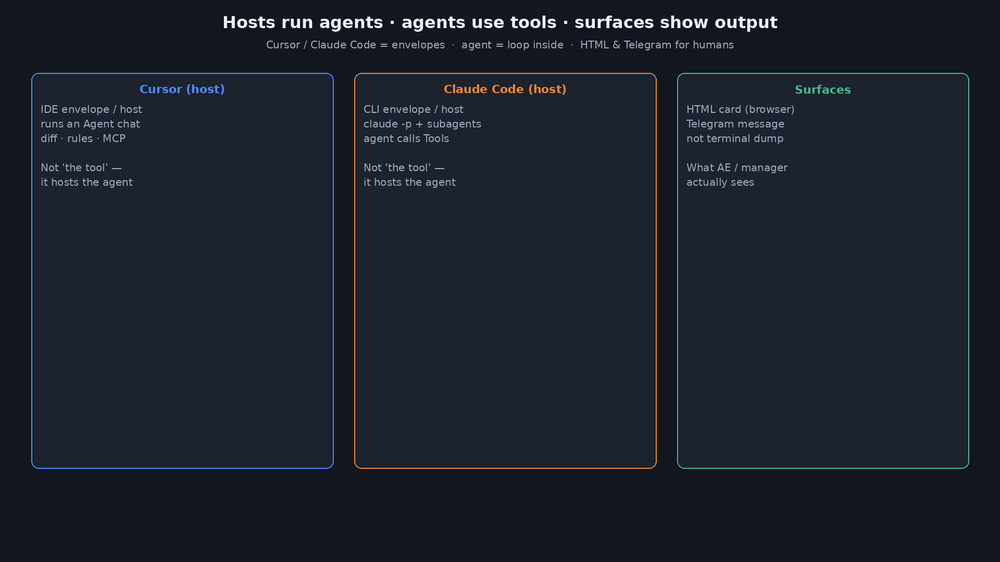
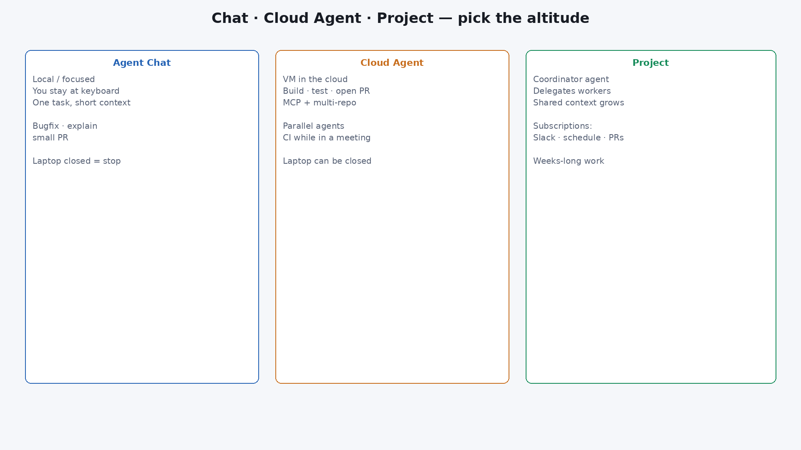
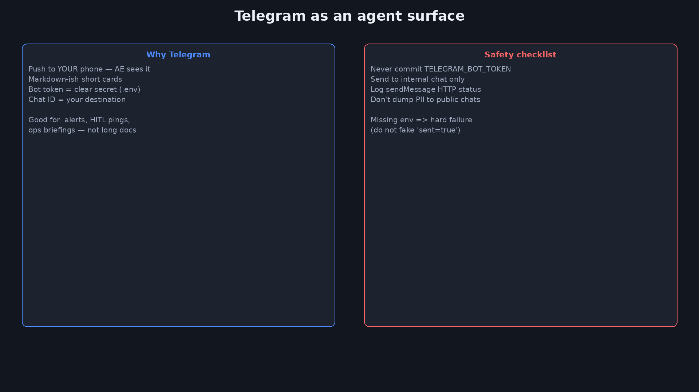

<div dir="rtl" lang="he">

<p align="center">
  
</p>

# ‏מפגש 8 — מצגת סטודנטים
## ‏Cursor · Claude Code · משטחי פלט (UI / Telegram)

> **משך משוער:** ~2.5–3.5 שעות (מילון + הדגמות חיות + Lab + Surfaces).  
> בלי Copilot — רק **Cursor** ו-**Claude Code** + Lab עם `ANTHROPIC_API_KEY`.  
> דגש: פלט **יפה** למשתמש (HTML בדפדפן · הודעת Telegram) — לא רק לוג בטרמינל.  
> תדריך מנהלים: [`08-exec-briefing.md`](08-exec-briefing.md)

---

# ‏חלק א׳ — פתיחה והדגמה

_מאיפה המשתמש רואה את הסוכן?_

## ‏1 — כותרת
> פתיחה — Coding agents + Surfaces

<p align="center">
  
</p>

**‏Cursor · Claude Code · משטחי פלט**  
מעטפות שמריצות agents — ו-runtime שמוציא כרטיס HTML / הודעת טלגרם



---

## ‏2 — מילון למפגש
| מונח | הסבר |
|---|---|
| ‏**Agent host / מעטפת** | סביבה שמריצה agent: מודל + לולאה + כלים (לא הכלי עצמו) |
| ‏**Cursor** | מעטפת ב-IDE: מריצה Agent עם diff, rules, MCP — אתם מאשרים שינויים |
| ‏**Claude Code** | מעטפת ב-CLI: `claude -p`, subagents, הרצות מוקלטות לתיקייה |
| ‏**Coding agent** | ה-agent שרץ *בתוך* Cursor/Claude Code ומשנה קבצים בריפו |
| ‏**Runtime agent** | Agent באפליקציה שלכם מול API (`surface_claude.py` + Anthropic) |
| ‏**Tool** | פעולה שה-agent קורא לה (Read/Write, `render_html_card`, `notify_telegram`…) |
| ‏**Surface** | משטח פלט לאדם: HTML, Telegram, UI — לא טרמינל בלבד |
| ‏**Bot token** | סוד של בוט טלגרם — לא בקוד ובלא git |
| ‏**Chat ID** | יעד השליחה בטלגרם |
| ‏**notify_telegram** | כלי שכותב הודעה **ושולח** לצ׳אט הפנימי (המרצה/AE) |
| ‏**Briefing card** | כרטיס HTML עם מספרים + route/severity + צבע |
| ‏**צ׳אט פנימי** | טלגרם שלכם / AE / מנהל מתקנים — כן שולחים |
| ‏**Nimbus** | דומיין מכירות (הצעות מחיר) — Lab A |
| ‏**Atlas Facility** | דומיין ניהול מתקנים (קריאות שירות) — Lab B · לא הזמנות לקוח |

---

## ‏3 — הדגמת פתיחה — HTML + טיוטת Telegram
תיקייה: `demos/08-surface-opening/` · **Claude Code** (או Cursor · `prompt-cursor.md`)

```bash
cd demos/08-surface-opening
cp .env.example .env   # חד־פעמי: TELEGRAM_BOT_TOKEN + TELEGRAM_CHAT_ID
./run-claude.sh reset
./run-claude.sh smb
./send-telegram.sh            # שולח אליכם לטלגרם
# פתחו out/briefing.html בדפדפן
./run-claude.sh enterprise && ./send-telegram.sh
```

- קלט: `data/sample_quote.json` · מפרט: `surface-spec.md`  
- HTML בדפדפן + **הודעה אמיתית** בטלגרם  

---

## ‏4 — מה ראינו — פירוק
| מה ראינו | מושג |
|---|---|
| כרטיס בדפדפן | Surface / UI |
| SMB ירוק · ENT ענבר | אותו pipeline, מסר לפי route |
| `./send-telegram.sh` אחרי הדמו | שליחה אמיתית לצ׳אט שלכם |
| Claude Code הרצה agent שכתב קבצים | מעטפת CLI + coding agent |

---

## ‏5 — מה היום (+ חזרה)
| נבנה היום | כבר למדנו |
|---|---|
| Cursor מול Claude Code כמעטפות | מפגש 5–7: demos עם Claude Code |
| HTML + Telegram כמשטחים | מפגש 3: כלים / observations |
| Lab A Nimbus + Lab B Atlas (Facility) | מפגש 7: שערי כסף על אותם מספרים |
| כללי סודות לבוט | מפגש 6: לא לשמור סודות ב-Store |

יעד: **~2.5–3.5 שעות**, הרבה הדגמות חיות.

---

## ‏6 — שאלת המפגש + תוצרים
**שאלה:** איפה המשתמש רואה את תוצר הסוכן — ואיך מגיעה התראה לנייד?

| תוצר | "עובד" |
|---|---|
| כרטיס HTML | נפתח בדפדפן, מספרים נכונים |
| טלגרם | הודעה מגיעה לצ׳אט שלכם |
| `notify_telegram` / `send-telegram.sh` | `sent=true` בלוג / API |
| הבחנה מעטפת IDE / מעטפת CLI / runtime | יודעים מתי מה |

---

# ‏חלק ב׳ — מעטפות שמריצות Agents

_Cursor ו-Claude Code ≠ הכלים; הם מריצים את ה-agent_

## ‏7 — למה לא Copilot במפגש הזה
הסילבוס מזכיר Copilot — **בהקלטה שלנו:** Cursor + Claude Code כמעטפות בלבד.

| שכבה | מה זה באמת | תפקיד אצלנו |
|---|---|---|
| Cursor | מעטפת IDE | מריצה Agent שעורכת ריפו / UI |
| Claude Code | מעטפת CLI | מריצה Agent בהדגמות `claude -p` |
| Anthropic API | מודל + tool-use | Runtime agent ב-Lab |
| Tools | Read/Write/`notify_telegram`… | הפעולות שה-agent קורא להן |


---

## ‏8 — Cursor כמעטפת (IDE host)
- אתם פותחים צ׳אט **Agent** — Cursor מריץ את ה-agent  
- Diff לפני Accept — האדם בשער  
- Rules (`.cursor/rules`) מגבילים/מכוונים את ה-agent  
- מתאים לשיפור CSS/HTML של הכרטיס  

הדגמה קצרה: פתחו `prompt-cursor.md` ב-Cursor ושפרו מרווחים ב-`briefing.html` **בלי** לשנות מספרים.

---

## ‏9 — Claude Code כמעטפת (CLI host)
```bash
claude -p "$(cat prompt-smb.md)" \
  --setting-sources project,local \
  --allowedTools "Read,Write,Edit,Glob,Grep,Task"
```

- `claude` = מעטפת; ה-agent בפנים משתמש ב-Tools ברשימה  
- `run-claude.sh` = חזרתיות להקלטה  
- subagent `surface` ב-`.claude/agents/` — עדיין בתוך אותה מעטפת  
- stream-json + filter — רואים קריאות כלי (Write) בזמן אמת  

---

## ‏10 — Coding agent ≠ Runtime agent
שניהם **agents**. ההבדל: באיזו מעטפת הם רצים ומה המטרה.

| | Coding (בתוך Cursor/Claude Code) | Runtime (באפליקציה) |
|---|---|---|
| מעטפת | IDE / CLI | הקוד שלכם + Anthropic |
| מתי | פיתוח / דמו בניה | שימוש אצל AE |
| Tools | קבצי ריפו (Read/Write/…) | `get_quote` · `render_*` · `send_*` |
| סודות | לא בקומיט | env בזמן ריצה |
| דוגמה | `demos/08-…` | `labs/08-…/surface_claude.py` |

---

# ‏חלק ג׳ — Surfaces

_HTML וטלגרם כערוצי פלט_

## ‏11 — מה זה Surface ולמה אכפת
טרמינל טוב למפתחים. AE ומנהל רוצים:

- כרטיס ויזואלי (HTML)  
- דחיפה לנייד (Telegram)  



---

## ‏12 — Pipeline: Quote → HTML → TG → Send?
1. `get_quote`  
2. `render_html_card` → `out/briefing.html`  
3. `notify_telegram` → כותב `telegram.txt` **ושולח** לצ׳אט הפנימי  

---

## ‏13 — HTML card — עקרונות
- קובץ יחיד · CSS פנימי · `dir="rtl"`  
- צבע לפי `route` (auto/hitl/blocked)  
- כותרת + טבלה + פוטר "טיוטה פנימית"  
- מספרים **רק** מה-JSON  

---

## ‏14 — Telegram כמשטח (עם שליחה)


| רכיב | תפקיד |
|---|---|
| Bot token | זהות הבוט (סוד ב-`.env`) |
| Chat ID | **הצ׳אט שלכם** — יעד השליחה |
| `notify_telegram` / `send-telegram.sh` | `sendMessage` אמיתי |

בלי env → כישלון ברור. עם env → ההודעה חייבת להגיע לנייד.

---

## ‏15 — פנימי כן · לקוח סופי לא
| ערוץ | שולחים? |
|---|---|
| טלגרם פנימי (מרצה / AE) | **כן** — זה המוצר של המפגש |
| HTML briefing | כן (קובץ / דפדפן) |
| מייל/הודעה ללקוח הסופי | לא אוטומטית (מפגש 7: Draft ≠ Send למייל) |

---

## ‏16 — סודות והגדרות
```bash
cp .env.example .env
# ANTHROPIC_API_KEY=...
# TELEGRAM_BOT_TOKEN=...
# TELEGRAM_CHAT_ID=...   # הצ׳אט האישי שלכם
```

- לא בקוד · לא ב-git · לא בצילום מסך  
- Chat ID: שלחו Start לבוט → `getUpdates` → `chat.id`  

---

## ‏17 — Guardrails למשטחים
- [ ] מספרים מכלי/JSON בלבד  
- [ ] HTML לא מריץ JS חיצוני לא מבוקר בדמו  
- [ ] שליחה לצ׳אט פנימי עובדת בהקלטה  
- [ ] אין token בלוגים  
- [ ] PII — לא לצ׳אט ציבורי  

---

## ‏18 — Anti-Patterns
| אנטי־דפוס | למה נשבר |
|---|---|
| "הסוכן ידפיס יפה בטרמינל" | המשתמש לא שם |
| שליחה ללקוח סופי בלי שער | ספאם / דליפה — צ׳אט פנימי כן |
| Token ב-repo | פריצה |
| HTML עם מספרים מהפרומפט | מחיר ישן/בדוי |
| לערבב Copilot כחובה | לא במסלול שלנו |

---

## ‏19 — Checklist לפני פיילוט Surface
- [ ] יש HTML שנפתח בלי שרת  
- [ ] יש `.env` עם token + chat id שלכם  
- [ ] הודעת SMB מגיעה לטלגרם  
- [ ] יש הפרדת Coding / Runtime  
- [ ] יש תרחיש SMB מול ENT **או** HVAC מול ELEV ויזואלית  

---

# ‏חלק ד׳ — Lab

_הרבה הרצות — רואים כרטיס וטלגרם_

## ‏20 — Lab — שני דומיינים (גיוון)
אותו דפוס משטחים · **שני עולמות עסקיים**:

| Lab | דומיין | תיקייה | מזהים |
|---|---|---|---|
| **A · Nimbus** | מכירות / הצעות מחיר | [`labs/08-agent-surfaces/`](labs/08-agent-surfaces/) | `L-SMB` · `L-ENT` · `L-UPSELL` |
| **B · Atlas** | ניהול מתקנים / קריאות שירות | [`labs/08-facility-surfaces/`](labs/08-facility-surfaces/) | `WO-HVAC` · `WO-ELEV` · `WO-ACCESS` |

דורש **`ANTHROPIC_API_KEY`** + **`TELEGRAM_*`** בשניהם.


מסר: Surface לא "שייך" רק ל-CRM מכירות — אותו pipeline עובד על Work Orders בבניין.

---

## ‏21 — Lab A (Nimbus) — מה נריץ
```bash
cd labs/08-agent-surfaces
python3 -m venv .venv && source .venv/bin/activate
pip install -r requirements.txt
cp .env.example .env   # מלאו ANTHROPIC + TELEGRAM_*

python3 surface_claude.py reset
python3 surface_claude.py chat --lead L-SMB --message "הכן כרטיס HTML ושלח סיכום לטלגרם שלי"
# פתחו out/briefing.html — ובדקו את הטלפון

python3 surface_claude.py chat --lead L-ENT --message "הכן כרטיס ושלח — ממתין למנהל"
python3 surface_claude.py chat --lead L-UPSELL --message "הכן כרטיס ושלח ללקוח קיים (upsell)"
python3 surface_claude.py notify --lead L-SMB   # שליחה חוזרת בלי LLM
python3 surface_claude.py show
```

---

## ‏22 — Lab A — Debrief
- [ ] ראיתי כרטיס ירוק ל-SMB וענבר ל-ENT  
- [ ] הודעות הגיעו לטלגרם האישי  
- [ ] בלוג: `TOOL -> notify_telegram` עם `sent=true`  
- [ ] בלי `.env` — כישלון ברור, לא "נשלח" מזויף  
- [ ] Upsell מסומן בכרטיס/הודעה  

---

## ‏23 — Lab B (Atlas) — קריאות שירות
תיקייה: [`labs/08-facility-surfaces/`](labs/08-facility-surfaces/) · דמו: [`demos/08-facility-opening/`](demos/08-facility-opening/)

**לא הזמנות לקוח** — מיזוג, מעלית, בקרת כניסה.

| מזהה | חומרה | צבע |
|---|---|---|
| `WO-HVAC` | `open` | כחול |
| `WO-ELEV` | `sla_breach` | אדום |
| `WO-ACCESS` | `blocked` | ענבר |

כלים: `get_work_order` · `render_html_card` · `notify_telegram`

---

## ‏24 — Lab B — מה נריץ
```bash
cd labs/08-facility-surfaces
python3 -m venv .venv && source .venv/bin/activate
pip install -r requirements.txt
cp .env.example .env   # או העתיקו מ-Lab A

python3 facility_claude.py reset
python3 facility_claude.py chat --wo WO-HVAC --message "הכן כרטיס ושלח התראה למנהל מתקנים"
python3 facility_claude.py chat --wo WO-ELEV --message "חריגת SLA — שלח עכשיו"
python3 facility_claude.py notify --wo WO-ACCESS
```

דמו קצר (Claude Code): `demos/08-facility-opening/` → `./run-claude.sh hvac|elev` → `./send-telegram.sh`

---

## ‏25 — Lab B — Debrief
- [ ] אין מחירים / מושבים — זה לא Nimbus  
- [ ] כרטיס אדום ל-`WO-ELEV` (חריגת SLA)  
- [ ] טלגרם עם `Atlas Facility`  
- [ ] אותו דפוס: get → HTML → notify  

---

# ‏חלק ה׳ — הדגמות נוספות וסיכום

## ‏26 — הדגמה — Cursor משפר UI
1. פתחו `out/briefing.html` אחרי Lab  
2. ב-Cursor: "שפר טיפוגרפיה ומרווחים בלי לשנות מספרים"  
3. רעננו בדפדפן  

מסר: מעטפת Cursor מריצה coding agent שמשפר Surface; ה-runtime agent מזין נתונים.

---

## ‏27 — הדגמה — כפתורים שמשנים פלט
| שינוי | תוצאה ויזואלית |
|---|---|
| `L-SMB` (Nimbus) | ירוק / approved |
| `L-ENT` (Nimbus) | ענבר / pending_manager |
| `WO-HVAC` (Atlas) | כחול / open |
| `WO-ELEV` (Atlas) | אדום / sla_breach |
| בלי `.env` | error ברור |
| עם `.env` | הודעה בטלגרם |

---

## ‏28 — באג: "נשלח" בלי אישור API
סימפטום: המודל כותב "שלחתי" אבל אין הודעה בנייד.  
בדיקה: אין `notify_telegram` עם `sent=true`, או `last_send.json` עם כשל.  
תיקון: האמת בתוצאת הכלי בלבד — לא בנרטיב המודל.

---

## ‏29 — Design Review — למי שולחים?
| שאלה | החלטה במפגש |
|---|---|
| למי הצ׳אט? | **פנימי** — המרצה / AE (כן שולחים) |
| ללקוח הסופי? | לא אוטומטית מהבוט הזה |
| מה בתוכן? | מספרים מה-Quote, בלי PII מיותר |
| Audit? | `telegram.txt` + `last_send.json` / לוג HTTP |

---

## ‏30 — ROI קצר למשטחים
| למי | ערך |
|---|---|
| AE / מנהל מתקנים | כרטיס מוכן + התראה בנייד |
| מנהל | רואה HITL / חריגת SLA בלי לפתוח מערכת |
| מפתח | אותו דפוס Surface — דומיינים שונים |

---

## ‏31 — סיכום
- Cursor / Claude Code = **מעטפות** שמריצות agents (לא "הכלים")  
- Surface = HTML / Telegram / UI  
- Coding agent ≠ Runtime agent  
- טלגרם פנימי = **שולחים**; לקוח סופי ≠ אוטומטי  
- Lab A (Nimbus) + Lab B (Atlas Facility) — אותו Surface, דומיינים שונים  
- במפגש הבא: **Testing ו-Debugging Agents**

---

## ‏32 — הכנה למפגש 9
- חשבו: איך בודקים ש-HTML מכיל את הסכום הנכון?  
- איך בודקים ש-send לא רץ בלי token?  
- רשמו 2 בדיקות שבירות שתרצו לראות בלוג  

---

## ‏33 — תרגיל בית
1. Lab A: הוסיפו שדה `valid_until` ל-JSON והציגו ב-HTML  
2. Lab B: הוסיפו קריאה `WO-CLEAN` (ניקיון) עם severity=`open`  
3. תעדו ב-README איך משיגים `TELEGRAM_CHAT_ID`  
4. בונוס: כלי `render_markdown_report` → `out/report.md` באחד הדומיינים  

</div>
